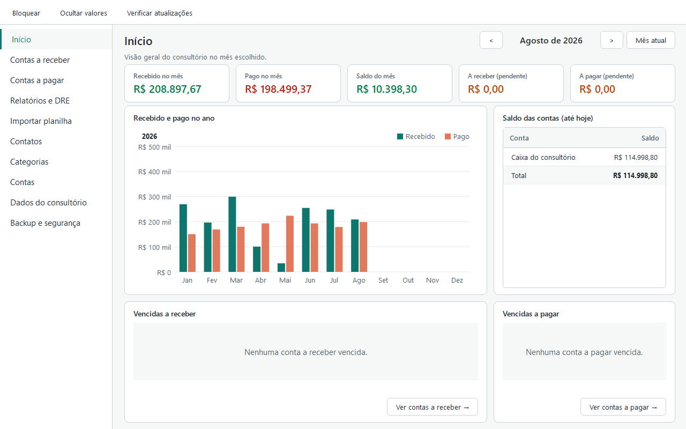
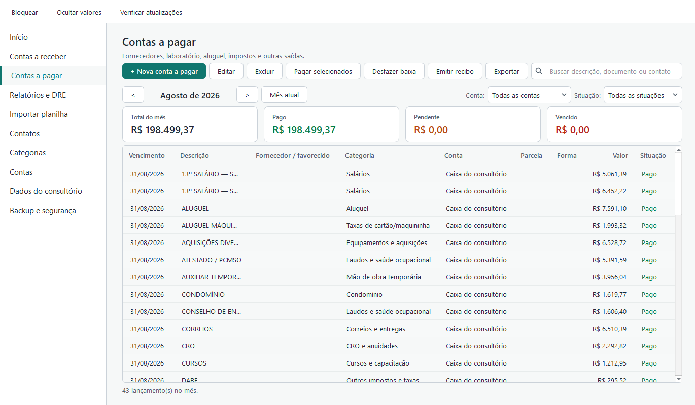
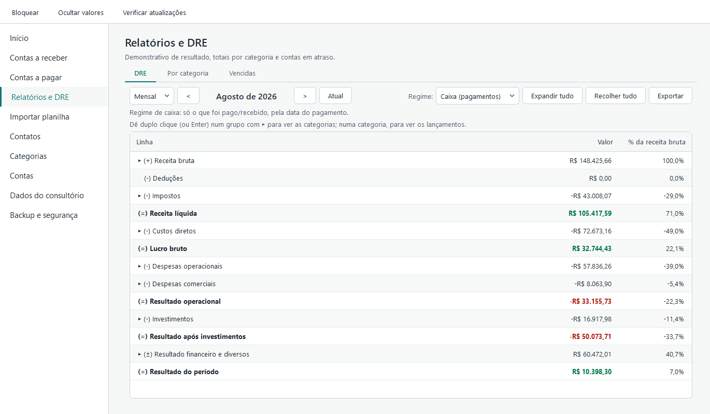
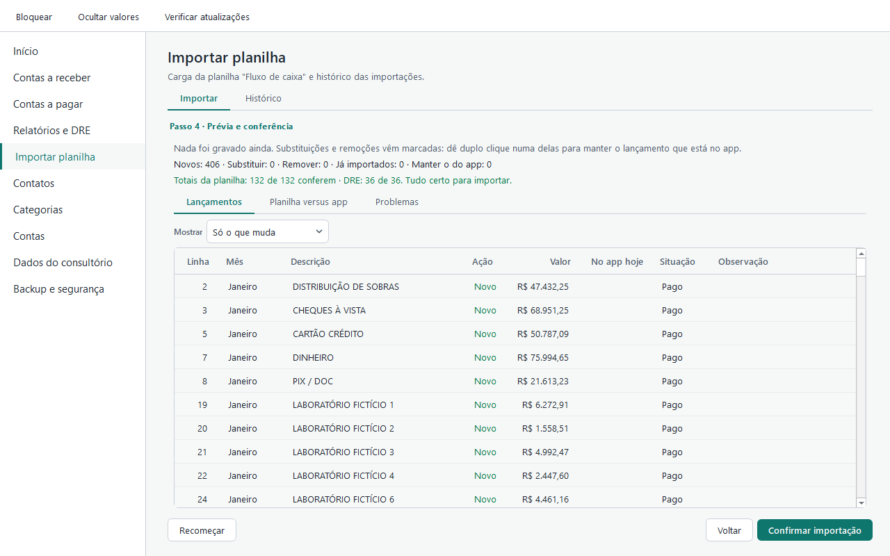
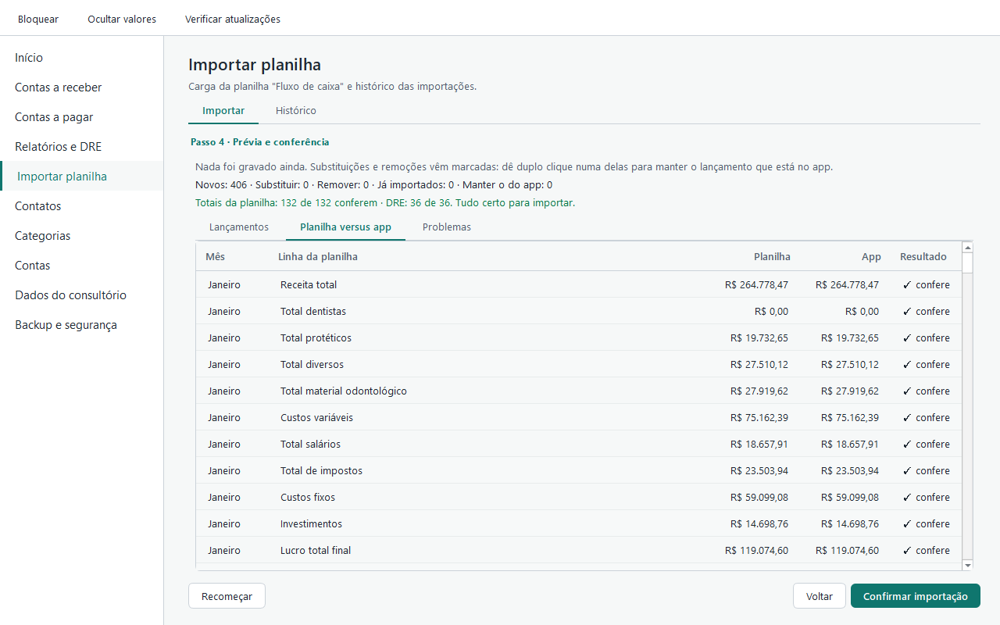
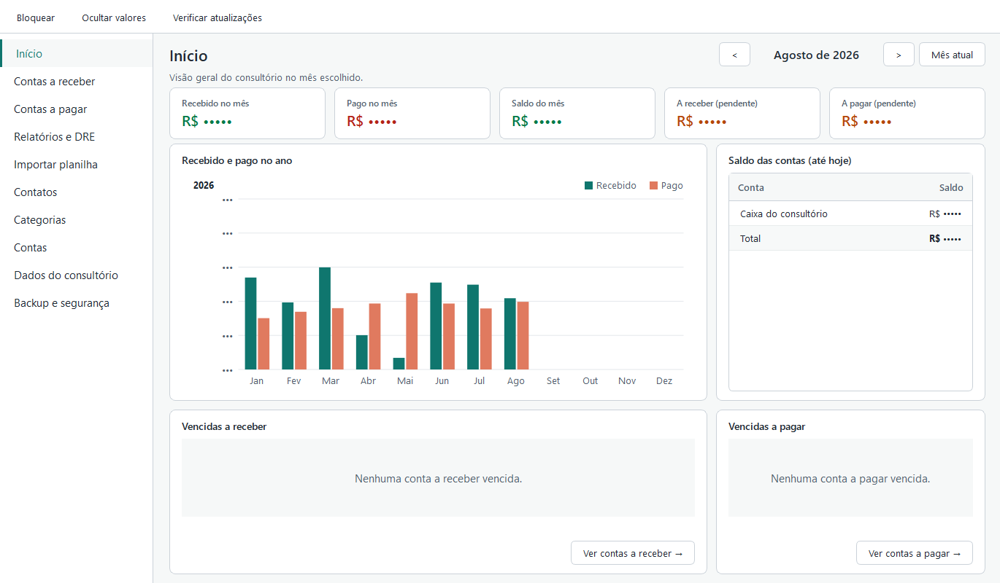
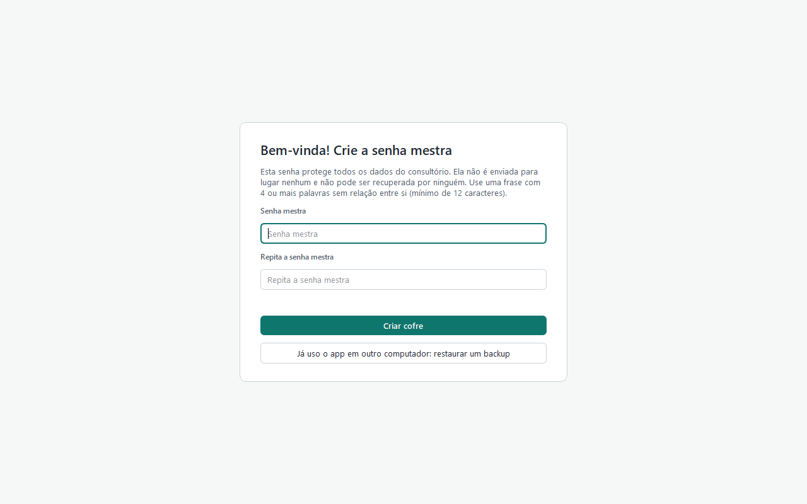

# EzFinance

App desktop de **gestão financeira para pequenas empresas**, hoje focado num consultório
odontológico: contas a receber e a pagar, parcelamento, DRE gerencial, recibos, importação de
planilhas e backup cifrado. Feito para Windows, **local-first** e **cifrado de ponta a ponta**.

Python 3.13 · PySide6 (Qt) · SQLCipher · PyNaCl/libsodium



> Todas as telas e dados deste repositório são **fictícios** (gerados pelos testes).

## Destaques

### Segurança como requisito nº 1
- **Banco cifrado (SQLCipher)** com chave derivada de uma hierarquia de chaves: senha mestra →
  **Argon2id** (libsodium) → chave que cifra uma chave de dados aleatória. Trocar a senha não recifra
  os dados; uma **chave de recuperação** em papel cifra uma segunda cópia da chave de dados.
- **Bloqueio automático** por inatividade e ao bloquear o Windows; ao bloquear, as chaves em memória
  são sobrescritas, o banco é fechado e as telas com dados são destruídas.
- **Backups cifrados** (`crypto_secretstream`, XChaCha20-Poly1305) com detecção de adulteração e de
  truncamento, conferidos logo após criados; restauração em duas etapas, retomável após queda de
  energia.
- **Atualizações assinadas** com [TUF](https://theupdateframework.io/) (`tufup`): nada sem assinatura
  válida é instalado; proteção contra *rollback*.
- **Planilhas tratadas como arquivo hostil:** `defusedxml` (XXE, *billion laughs*), limites contra
  *zip bomb*, nada é executado (só valores), e nenhum conteúdo da planilha vai para log.
- **Logs com lista de campos permitidos** e testes "canário" que falham se um dado sensível aparecer.
- Texto de usuário sempre exibido como texto simples no Qt (o equivalente a evitar XSS); zero
  telemetria; minimização de dados de pacientes (LGPD).

### Engenharia
- Arquitetura em camadas (**domínio / aplicação / infraestrutura / interface**), entidades imutáveis,
  *Repository* + *Unit of Work* com concorrência otimista e *outbox* para a sincronização futura.
- Interface **MVVM** organizada por funcionalidade; trabalho pesado fora da thread da interface.
- **Dinheiro só em centavos inteiros** (nunca `float`), inclusive na leitura de planilhas.
- **~590 testes** (unitários, integração num SQLCipher real, interface com pytest-qt, *hypothesis*),
  `mypy --strict`, `ruff`, `bandit`.
- **CI no GitHub Actions** (actions fixadas por SHA): testes, CodeQL, Bandit, `pip-audit` com hashes,
  `gitleaks` no histórico, Dependabot.
- Decisões registradas em **ADRs** ([`docs/adr/`](docs/adr/)) e um documento de projeto completo
  ([`docs/PROJETO.md`](docs/PROJETO.md)) com modelo de ameaças e roadmap.

## Telas

| | |
|---|---|
|  |  |
| **Contas a pagar** com filtros, baixa em lote e recibo | **DRE** gerencial (caixa ou competência), detalhável até o lançamento |
|  |  |
| **Importação de planilha:** prévia antes de gravar | **Conferência** de cada total da planilha contra o app, mês a mês |
|  |  |
| **Ocultar valores** em todas as telas (Ctrl+H) | **Senha mestra** no primeiro uso |

## Importação de planilha (exemplo de feature completa)

Lê a planilha mensal de fluxo de caixa da empresa (`.xlsx` ou `.csv`) e transforma cada valor em
lançamento. Antes de gravar, recalcula **todos os totais da própria planilha** e compara com o que o
app vai registrar; qualquer diferença bloqueia a importação (sem importação parcial). Reimportar não
duplica: cada célula tem uma identidade única, o que mudou é substituído e **o que foi alterado no app
é preservado**. Cada importação pode ser desfeita. Detalhes em
[`ADR-0009`](docs/adr/0009-importacao-de-planilha.md) e no guia [`docs/IMPORTACAO.md`](docs/IMPORTACAO.md).

## Estado

Versão **0.7.1** — fase 1 (MVP de uso diário numa máquina) em andamento. A sincronização cifrada
entre máquinas (Supabase como armazenamento cego, com RLS e MFA) está planejada para a fase 2.
Roadmap em [`docs/PROJETO.md`](docs/PROJETO.md) §12.

## Rodar localmente

Pré-requisitos: Windows, Python 3.13 e [uv](https://docs.astral.sh/uv/).

```bash
uv sync --locked                                   # ambiente a partir do uv.lock (com hashes)
uv run pytest                                      # testes
uv run ruff check . && uv run mypy                 # lint e tipagem estrita
APPFIN_DATA_DIR=./local-data uv run appfin         # abre o app com uma pasta de dados de teste
```

## Licença

Todos os direitos reservados. O código está disponível para leitura e avaliação; uso, cópia ou
distribuição exigem autorização do autor.
