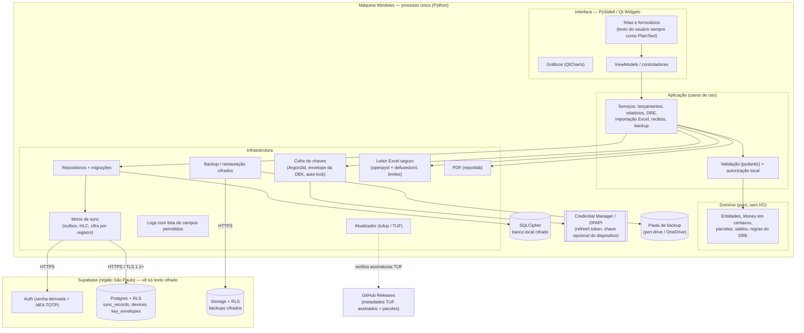
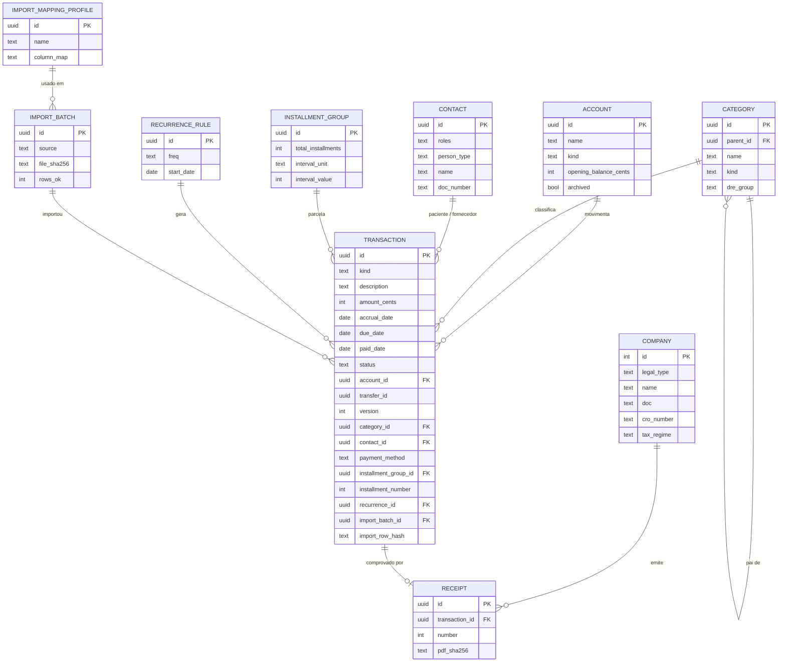

# Projeto — App de Gestão Financeira para Consultório Odontológico

> **Status:** rascunho para revisão (v0.3 — 02/11/2026). Nenhum código foi escrito.
> **v0.3:** consultório **PJ**; DRE com **seletor caixa/competência** (novo campo `accrual_date`);
> uma única máquina até a fase 2; importação Excel com estrutura genérica até chegar o modelo;
> análise das skills do projeto em `docs/ANALISE_SKILLS.md`.
> **Nome provisório:** "AppFinanceiro" (a definir; não usar a marca "app de referência").
> **Mudanças desde a v0.1:** novo contexto de uso (consultório odontológico), stack trocada para
> **Python + PySide6**, importação do app de referência removida, **importação de planilha Excel** incluída no MVP,
> DRE, recibos e dados da empresa mantidos, LGPD revista (agora se aplica), assinatura de código adiada.

## Legenda usada no documento

| Marca | Significado |
|---|---|
| 🔶 **A confirmar** | Indício nos arquivos, mas o comportamento exato não foi observado |
| 💡 **Premissa** | Decisão que adotei para não travar o trabalho; pode ser revista |
| 🗣️ **Decidido** | Resposta sua às perguntas da v0.1 |

---

## 1. Visão e objetivos

**Visão:** um app desktop de gestão financeira para um **consultório odontológico pequeno**, usado por
uma pessoa, **seguro por padrão**, que funciona offline, mantém uma cópia cifrada na nuvem e pode ser
usado em mais de uma máquina, sem que o provedor de nuvem consiga ler os dados.

**Objetivos (em ordem de prioridade):**
1. **Segurança e privacidade:** criptografia ponta a ponta, sem telemetria, conformidade com a LGPD (há dados de pacientes).
2. **Durabilidade:** os dados não se perdem. Banco local + sincronização cifrada + backups versionados, com restauração testada.
3. **Paridade funcional com o app de referência**, incluindo DRE, recibos e dados da empresa (🗣️).
4. **Importar planilhas Excel**, para não ter que digitar tudo à mão (🗣️ a maior lacuna do app de referência).
5. **Manutenibilidade:** Python (🗣️ sua preferência), código simples e bem testado, fácil de evoluir com IA.

**Fora de escopo (por ora):** prontuário clínico e agenda de pacientes, app mobile, integração bancária
automática, emissão de NF-e/NFS-e, multiempresa, macOS/Linux (🗣️ só Windows a princípio).

**Contexto (🗣️):**
- **Uma usuária** (a dentista, ou quem cuidar do financeiro) num consultório pequeno.
- **Só Windows** a princípio.
- **Começa do zero**: não há dados do app de referência para migrar. A carga inicial será por **planilha Excel** (modelo a ser enviado).
- **Uso exclusivo do consultório**: assinatura de código e custos de nuvem pagos ficam para depois.
- Perder a senha mestra **e** a chave de recuperação = perder os dados: **aceito** (preço da criptografia ponta a ponta).

💡 **Premissas:**
- 🗣️ **Uma única máquina** (a do consultório) nas fases 0 e 1, para testes e ajustes. A sincronização entre máquinas fica para a fase 2.
- O PC do consultório **pode ser compartilhado** com outras pessoas (recepção). Por isso o bloqueio automático e uma conta do Windows separada são importantes.
- 🗣️ O consultório é **pessoa jurídica**. O padrão é PJ; o perfil PF continua possível no cadastro da empresa. 🔶 Regime tributário (Simples ou Presumido) a confirmar com o contador; muda só o grupo "Impostos" das categorias padrão.

---

## 2. Referência funcional

O escopo foi definido a partir de um app comercial de finanças usado **só como referência funcional** (o comportamento visível nas telas). Nenhum código, ícone, texto ou marca dele foi reaproveitado. O levantamento detalhado fica num documento interno.

## 3. Melhorias desejadas

🗣️ Você preferiu não detalhar a lista agora. A necessidade principal declarada é a **importação de planilha Excel**.

| # | Melhoria | Motivo | Fase |
|---|---|---|---|
| **M1** | **Importar planilha Excel (.xlsx)** com assistente de mapeamento de colunas, prévia, validação linha a linha, deduplicação e desfazer importação | 🗣️ Hoje tudo precisa ser digitado à mão | **MVP** |
| M2 | Banco **criptografado** + senha mestra + bloqueio automático | Dados de pacientes e financeiros em claro no app de referência | MVP |
| M3 | **Zero telemetria**, nenhum compartilhamento | O app de referência envia dados cadastrais | MVP |
| M4 | Backup **cifrado, versionado e verificado**, com cópia fora da máquina | Backup do app de referência é manual e sem cifra | MVP |
| M5 | Categorias e DRE **odontológicos** prontos | Os padrões do app de referência são de comércio | MVP |
| M6 | Exportar **Excel** além de CSV | O contador costuma pedir planilha | MVP |
| M7 | Parcelamento também por **meses** (além de dias) | O app de referência só tem "a cada X dias" | MVP |
| M8 | Sincronização entre máquinas (criptografia ponta a ponta) | Requisito original | v2 |
| M9 | Transferências, recorrências, lembretes | Não existem | v2 |
| M10 | Recebíveis de cartão (taxa e prazo da maquininha), convênios | Realidade de consultório | Futuro |
| M11 | Importação OFX de extratos | Menos digitação | Futuro |

---

## 4. Stack escolhida + tabela comparativa

### 4.1 Comparativo (revisto com as suas respostas)

Escala: ●●● ótimo · ●● bom · ● fraco.

| Critério | **Python + PySide6** | **Electron** (Node/TS) | **Tauri 2** (Rust + TS) | **.NET + Avalonia** |
|---|---|---|---|---|
| Sua familiaridade (🗣️) | ●●● **preferida** | ●●● **mais familiar** | ● nunca usou Rust | ● |
| Instalador Windows | ●● PyInstaller + Inno Setup | ●●● electron-builder | ●●● | ●●● |
| Atualização **assinada** sem certificado pago | ●●● **tufup** (implementação do padrão TUF, metadados assinados com Ed25519, proteção contra rollback) | ●● electron-updater confia no HTTPS + hash; a assinatura forte depende do Authenticode (pago) | ●●● updater exige Ed25519 | ●● Velopack depende do Authenticode |
| Superfície de ataque | ●● sem webview, então não existe a classe de ataques XSS (atenção ao *rich text* do Qt); executável extraível (sem impacto, porque não haverá segredos nele) | ● Chromium + Node; exige configuração rigorosa (sandbox, contextIsolation, Fuses) | ●●● | ●●● |
| Criptografia madura | ●●● **PyNaCl/libsodium** (Argon2id, XChaCha20-Poly1305), `cryptography`, SQLCipher (`sqlcipher3`) | ●● Node `crypto`, libsodium-wrappers, SQLCipher via better-sqlite3-multiple-ciphers | ●●● | ●●● |
| Apagar chaves da memória | ● limitado no CPython (mitigação parcial com `bytearray` + sobrescrita) | ● limitado no V8 | ●●● `zeroize` | ●● |
| Cadeia de suprimentos | ●● poucas dependências; PyPI com hashes fixados | ● ecossistema npm, com ataques frequentes (worms em pacotes populares em 2025) | ●● | ●●● |
| Interface e gráficos | ●● Qt Widgets com tema próprio (QSS) fica moderno; **QtCharts** interativo; reportlab para PDF | ●●● web | ●●● web | ●● |
| Tamanho / desempenho | ● ~80–120 MB (irrelevante para 1–2 máquinas) | ● ~100–150 MB | ●●● | ●● |
| Manutenção com IA | ●●● Python é o mais legível | ●●● | ●● | ●●● |

### 4.2 Recomendação: **Python 3.13 + PySide6 (Qt 6 Widgets)**

**Por que mudou desde a v0.1:** o Tauri continua tecnicamente excelente, mas o maior risco de segurança
num projeto mantido por uma pessoa é **não conseguir ler e revisar o próprio código**. Rust seria uma
barreira. Entre Python (sua preferência) e Node (sua maior familiaridade), Python ganha porque:
1. **Atualizações assinadas sem custo:** o tufup (TUF) dá verificação criptográfica forte sem certificado pago, o que combina com a sua decisão de adiar a assinatura de código.
2. **Sem webview:** elimina XSS e as armadilhas de configuração do Electron.
3. **Menos dependências e cadeia de suprimentos mais controlável** que o npm.
4. **Criptografia de primeira linha** via libsodium (PyNaCl).
5. A IA ajuda muito bem em Python, e o código fica muito legível para você.

**Limitações aceitas, com mitigação:**

| Limitação | Mitigação |
|---|---|
| Não dá para apagar chaves da memória com garantia | Chaves em `bytearray`, sobrescritas ao bloquear; processo encerrado no bloqueio longo; o risco de malware local já é residual (seção 7) |
| Executável extraível | Por projeto, **nenhum segredo** no executável; segurança não depende de obscuridade |
| Falsos positivos de antivírus (PyInstaller sem assinatura) | Build *onedir* (não *onefile*), sem UPX; enviar o build para análise da Microsoft se o Defender acusar; assinatura de código quando você decidir (seção 11) |
| Visual "datado" do Qt Widgets | Tema próprio com QSS, ícones SVG, tema claro/escuro, QtCharts |

**Alternativa válida:** Electron + TypeScript, se você preferir trabalhar em Node. Exigiria a checklist
de *hardening* do Electron e uma verificação Ed25519 própria nas atualizações.

### 4.3 Componentes previstos (versões exatas fixadas na fase 0)

| Função | Biblioteca | Licença |
|---|---|---|
| Linguagem | Python 3.13 (🔶 confirmar compatibilidade de todas as libs na fase 0) | PSF |
| Interface | PySide6 (Qt Widgets) + QSS | LGPL |
| Gráficos | PySide6.QtCharts | LGPL/GPL (🔶 confirmar o módulo usado; alternativa: pyqtgraph, MIT) |
| Banco local | SQLite + **SQLCipher** via `sqlcipher3` (🔶 confirmar wheels para Windows/3.13) | BSD/Zlib |
| Criptografia | **PyNaCl** (Argon2id, XChaCha20-Poly1305), `cryptography` (HKDF) | Apache-2 / BSD |
| Cofre do Windows | `keyring` (Credential Manager) + DPAPI (`pywin32`/`win32crypt`) | MIT / PSF |
| Excel | **openpyxl** (somente leitura, `data_only=True`) + **defusedxml** | MIT / PSF |
| PDF | reportlab | BSD |
| Rede | `httpx` + `truststore` (usa o repositório de certificados do Windows) | BSD / MIT |
| Validação | `pydantic` v2 (DTOs/validação) | MIT |
| Atualização | **tufup** (sobre python-tuf) | MIT / Apache-2 |
| Empacotamento | PyInstaller (*onedir*) + Inno Setup | GPL com exceção de bootloader / livre |
| Ferramentas | `uv` (lockfile com hashes), ruff, mypy (`--strict`), pytest, pytest-qt, hypothesis | — |
| Backend nuvem | Supabase (Auth + Postgres/RLS + Storage), plano **gratuito** por enquanto (🗣️) | — |

---

## 5. Arquitetura

### 5.1 Decisão de dados: **local-first + sincronização com criptografia ponta a ponta (E2EE)** (mantida)

| Critério | Firebase | Supabase com dados em claro | **Local-first + E2EE (Supabase "cego")** |
|---|---|---|---|
| Offline | ●● (sem SDK oficial para Python desktop; seria REST) | ● | ●●● banco local é a fonte da verdade |
| Quem lê os dados | Google + quem explorar uma *Rule* errada | Supabase/AWS + quem explorar uma *policy* errada | **Só a usuária** |
| Risco desktop | A configuração fica no cliente (pública); toda a proteção depende de Auth + Rules | A `anon key` fica no cliente (pública); toda a proteção depende de RLS; a `service_role` nunca pode ir no app | Uma policy errada só expõe texto cifrado e metadados |
| MFA | TOTP exige Identity Platform/Blaze | TOTP incluso | TOTP incluso |
| Custo | Grátis (MFA pode exigir plano pago) | Grátis; o projeto **pausa após ~7 dias sem uso** | Grátis; a pausa não afeta o uso local |
| Dependência do fornecedor | Alta | Baixa | **Mínima** (adaptador trocável) |
| LGPD com dados de pacientes | Operador lê os dados | Operador lê os dados | **Operador não consegue ler** (mitigação forte) |
| Complexidade | Média | Média | Alta (é o preço da privacidade) |

**Recomendação:** local-first com E2EE, usando o **Supabase gratuito** como armazenamento cego, atrás
de uma interface `SyncBackend` trocável.

**Sobre a pausa do plano gratuito:** se o projeto pausar, o app continua funcionando normalmente
(é local); só a sincronização e o backup na nuvem esperam. O app avisa quando o último backup na nuvem
tiver mais de 7 dias, e o projeto pode ser reativado no painel do Supabase. Os backups numa pasta/pen
drive continuam sendo a segunda cópia independente (regra 3-2-1).

### 5.2 Diagrama de componentes



### 5.3 Camadas e regras

| Camada | Responsabilidade | Regras |
|---|---|---|
| Interface | Exibir e capturar dados | Não acessa banco nem cripto diretamente. Todo texto vindo do usuário ou de planilhas é exibido como **`Qt.PlainText`** (no Qt, um QLabel interpreta HTML automaticamente) |
| Aplicação | Casos de uso, transações, orquestração | Entrada validada por modelos `pydantic` (tipos, tamanhos, enums) |
| Domínio | Regras puras e testáveis | Dinheiro **sempre `int` em centavos**; nada de `float`. `Decimal` só na conversão de entrada (planilhas) |
| Infraestrutura | Banco, cripto, rede, arquivos | SQL **somente parametrizado**; toda escrita gera uma entrada na `outbox` na mesma transação |

### 5.4 Sincronização (resumo)

1. Alteração local = entidade + entrada na `outbox` (mesma transação).
2. Push: serializa a entidade inteira, cifra com a DEK (XChaCha20-Poly1305, AAD = user_id‖record_id‖hlc‖key_version) e faz upsert em `sync_records` só se o `hlc` for maior.
3. Pull: busca `server_seq > cursor` (nunca pelo relógio do cliente), decifra, **revalida** e aplica pela regra *last-writer-wins* por registro (HLC).
   **Conflitos (D6):** quando as duas versões alteraram **valor, data (competência/vencimento/pagamento) ou conta**,
   a versão perdedora é guardada em `sync_conflict` e aparece em "Conflitos para revisar". A usuária escolhe
   manter a atual ou restaurar a outra. Nada se perde em silêncio. Para os demais campos vale só o LWW.
4. Exclusões viram *tombstones* (compactados depois de 90 dias).
5. O tipo da entidade fica **dentro** do texto cifrado.

---

## 6. Modelo de dados

### 6.1 Convenções
- `id`: **UUID v7** gerado no cliente.
- Dinheiro: `*_cents INTEGER`; moeda BRL.
- Datas contábeis `YYYY-MM-DD`; carimbos de tempo em UTC ISO-8601.
- Toda entidade sincronizável: `created_at`, `updated_at`, `deleted_at`, **`version`** (inteiro, concorrência otimista local: o `update` exige a versão lida, senão `ConcurrencyConflict`), `hlc` (ordem na sincronização, fase 2), `origin_device_id` (D4).
- **Sem `owner_id` no banco local** (D3): o banco é de uma única usuária e todo cifrado. O isolamento por usuário existe no servidor (`user_id` + RLS).
- `CHECK` constraints e `PRAGMA foreign_keys=ON`.

### 6.2 Entidades locais (SQLCipher)

| Entidade | Campos | Notas |
|---|---|---|
| `company` | id = 1, legal_type (`pf`,`pj`), name, trade_name, doc (CPF/CNPJ), cro_number, responsible, address, phone, whatsapp, email, logo (blob), tax_regime (`carne_leao`,`simples`,`presumido`,`outro`) | 🗣️ Dados da empresa. Usado em recibos, relatórios e DRE |
| `account` | id, name, kind (`cash`,`checking`,`savings`,`card_acquirer`,`other`), opening_balance_cents, opening_date, archived | "Contas caixa" ampliadas |
| `category` | id, parent_id, name, kind (`income`,`expense`,`both`), dre_group, archived | 2 níveis |
| `contact` | id, roles (`patient`,`supplier`,`insurer`,`other` — conjunto), person_type (`pf`,`pj`), name, doc_number, phone, email, address (rua, número, bairro, cidade, UF, CEP), notes | Dados de pacientes: **minimizar** (seção 7.12) |
| `transaction` | id, kind (`income`,`expense`,`transfer_out`,`transfer_in`), description, amount_cents, **accrual_date** (competência), due_date, paid_date, status (`pending`,`paid`,`cancelled`), account_id, **transfer_id** (D5: liga as duas pernas de uma transferência), category_id, contact_id, payment_method (`cash`,`pix`,`debit`,`credit`,`boleto`,`transfer`,`check`,`other`), document_number, official_receipt_ref, notes, installment_group_id, installment_number, recurrence_id, import_batch_id, import_row_hash | "Vencida" é **calculada** |
| `installment_group` | id, total_installments, interval_unit (`day`,`month`), interval_value, total_amount_cents | Diferença de arredondamento vai para a 1ª parcela (💡) |
| `recurrence_rule` | id, template, freq, interval, by_month_day, start_date, end_date, last_generated_date | v2 |
| `receipt` | id, transaction_id, number (sequencial), issued_at, pdf_sha256 | Numeração sequencial dos recibos internos |
| `import_batch` | id, source (`xlsx`,`csv`), file_name, file_sha256, mapping_profile_id, imported_at, rows_total, rows_ok, rows_skipped, rows_error, undone_at | Permite **desfazer** uma importação |
| `import_mapping_profile` | id, name, sheet_name, header_row, column_map (JSON), date_format, decimal_sep, defaults (JSON) | Mapeamento reutilizável da planilha |
| `setting` | key, value | Preferências não sensíveis |
| `outbox`, `sync_state`, `device` | (técnicas) | Não sincronizam |
| `sync_conflict` *(técnica, fase 2)* | id, record_id, entity, losing_payload (cifrado pelo SQLCipher), detected_at, resolved_at, resolution | Lista "Conflitos para revisar" (D6) |
| *Futuro:* `tag`, `transaction_tag`, `transaction_split`, `budget`, `goal`, `attachment`, `card_receivable` | — | — |

### 6.3 Tabelas no servidor (Supabase, somente dados cifrados)

| Tabela | Campos | RLS |
|---|---|---|
| `devices` | id, user_id, name_ciphertext, created_at, revoked_at | `user_id = auth.uid()` + aal2 |
| `key_envelopes` | user_id, kdf_params, salt, wrapped_dek, wrapped_dek_recovery, key_version | `user_id = auth.uid()` + **aal2** |
| `sync_records` | user_id, record_id, hlc, server_seq, device_id, key_version, nonce, ciphertext (tamanho limitado), deleted, updated_at | `user_id = auth.uid()` + aal2; `hlc` monotônico |
| Storage `backups/{user_id}/…` | arquivos `.bkp` cifrados | prefixo = `auth.uid()` + aal2 |

### 6.4 Diagrama ER (local)



**Transferências (D5):** uma transferência são **duas linhas** (`transfer_out` na conta de origem e
`transfer_in` na de destino), com o mesmo `transfer_id` e o mesmo valor, gravadas na mesma transação
atômica. Editar ou excluir uma perna altera as duas. Transferências **não** entram no DRE nem nos
relatórios de receita/despesa.

**Saldo da conta** = `opening_balance` + Σ entradas pagas (`income`, `transfer_in`) − Σ saídas pagas (`expense`, `transfer_out`).

### 6.5 Categorias e DRE padrão (odontologia) — 💡 para validar com o contador

| Grupo DRE | Categorias de exemplo |
|---|---|
| (+) Receita bruta | Tratamentos particulares, Convênios odontológicos, Outras receitas operacionais |
| (−) Deduções | Descontos concedidos, Glosas de convênio, Taxas de cartão/maquininha |
| (−) Impostos | ISS, Simples Nacional / DAS, Carnê-leão (PF), IRPJ/CSLL (Presumido) |
| (−) Custos diretos (no lugar de "CMV") | Materiais odontológicos, Laboratório de prótese, Descartáveis e esterilização, Dentista parceiro / repasse |
| (−) Despesas operacionais (fixas) | Aluguel, Condomínio, Energia, Água, Internet/Telefone, Salários, Pró-labore, INSS/FGTS, Contador, Software, Manutenção de equipamentos, Coleta de resíduos, CRO / anuidades, Seguros |
| (−) Despesas comerciais | Marketing, Redes sociais, Brindes |
| (±) Resultado financeiro / diversos | Rendimentos, Juros e tarifas bancárias, Outras |
| (=) Resultado do período | — |

**Regime do DRE (🗣️ P13):** a tela do DRE (e o relatório por categoria) tem um **seletor "Caixa | Competência"**
na hora de visualizar:
- **Caixa:** considera só os lançamentos **pagos**, pela `paid_date`.
- **Competência:** considera todos os lançamentos não cancelados, pela `accrual_date`.

Preenchimento de `accrual_date`: por padrão, a **data do atendimento/compra**. No parcelamento, todas as
parcelas recebem a **mesma** competência (a data da venda do tratamento), enquanto os vencimentos variam.
O campo é editável e aparece no formulário em "Outras opções". Lançamentos importados sem competência
usam o vencimento. 🔶 Validar essa regra com o contador.

---

## 7. Segurança (requisito crítico)

### 7.1 Ativos
| Ativo | Sensibilidade |
|---|---|
| **Dados de pacientes** (nome, CPF, contato, histórico de pagamentos, que pode revelar tratamentos) | **Alta** (dado pessoal; potencialmente dado de saúde) |
| Dados financeiros do consultório | Alta |
| Senha mestra, KEK, DEK, chave de recuperação | **Crítica** |
| Tokens de sessão do Supabase | Alta |
| Backups | Alta (cifrados) |
| Chaves de assinatura das atualizações (TUF *root*, *targets*) | **Crítica** |
| Contas GitHub/Supabase do desenvolvedor | **Crítica** |

### 7.2 Atacantes
1. Ladrão ou alguém com acesso físico (PC do consultório, notebook).
2. **Pessoa do consultório com acesso ao PC** (recepção, visitante) enquanto o app está aberto.
3. Malware com o usuário do Windows (inclusive vindo de e-mail ou de **planilha recebida**).
4. Senha vazada (phishing, reutilização).
5. Acesso indevido ao backend (falha ou policy errada no Supabase).
6. Atacante na rede (Wi-Fi do consultório, MITM).
7. Dependência comprometida (PyPI) ou Action do GitHub comprometida.
8. Atualização maliciosa.

### 7.3 Modelo de ameaças (STRIDE)

| # | Vetor | STRIDE | Mitigações | Risco residual |
|---|---|---|---|---|
| T1 | **Máquina roubada** | I | SQLCipher (AES-256); DEK nunca gravada em claro; chave derivada por **Argon2id** (~1 s); **BitLocker** obrigatório no checklist de instalação; backups cifrados | Força bruta offline contra senha fraca → senha forte obrigatória (≥ 12 caracteres ou frase-senha, medidor de força) |
| T2 | **Acesso oportunista no consultório** | I, T | **Bloqueio automático** (padrão 3 min no consultório), ao bloquear o Windows e ao suspender; atalho para bloquear na hora (`Ctrl+L`); conta do Windows própria; botão global **"Ocultar valores"** (`R$ •••••`) já no MVP (D8), com opção de abrir o app com os valores ocultos | Alguém usando o app desbloqueado nos minutos antes do bloqueio |
| T3 | **Malware local** | I, T, E | Bloqueio limpa as chaves e a interface; nenhum arquivo temporário em claro; exportações (PDF/Excel/CSV) com aviso de que saem sem cifra; área de transferência limpa em 30 s | **Não há defesa completa** contra malware com o usuário logado enquanto o app está desbloqueado. Mitigação real: Windows atualizado, Defender, sem rodar como administrador |
| T4 | **Planilha maliciosa** (macro, *zip bomb*, *XML bomb*, fórmula) | T, D, E | openpyxl **nunca executa macros**; `.xlsm` aceito só para ler valores (com aviso); **defusedxml** contra XXE e *billion laughs*; limites de tamanho do arquivo (ex.: 20 MB), do descompactado e de linhas/colunas; `data_only=True` (lê o valor calculado e ignora a fórmula); a planilha nunca é aberta pelo Excel pelo app; validação de cada célula | Nenhum relevante |
| T5 | **Credencial vazada** | S | MFA TOTP obrigatório (RLS exige aal2); senha de login **derivada** da senha mestra (o servidor nunca a vê); sem a senha mestra o atacante só obtém texto cifrado; alerta de novo dispositivo; revogação de dispositivos | Senha mestra + TOTP vazados juntos |
| T6 | **Acesso indevido ao backend** | I, T, D | E2EE; AEAD com AAD impede trocar registros; RLS *deny-by-default* testada; backups também **fora** do Supabase | Metadados (volume, horários); apagamento remoto → recuperação local |
| T7 | **Interceptação de rede** | I, T | HTTPS obrigatório, TLS 1.2+, validação estrita de certificados (`truststore`); conteúdo já cifrado | — |
| T8 | **Dependência comprometida** | T, E | `uv.lock` com **hashes**; versões exatas; `pip-audit`; Dependabot; revisão de toda dependência nova; poucas dependências; Actions fixadas por SHA | Pacote malicioso ainda não detectado |
| T9 | **Atualização maliciosa** | T, E | **tufup/TUF**: metadados assinados (Ed25519), chave *root* **offline**, expiração de metadados, proteção contra *rollback* e *freeze*; pacotes verificados por hash antes de instalar; confirmação da usuária | Sem Authenticode por enquanto: o **primeiro** instalador é confiado manualmente (conferir o SHA-256 publicado) |
| T10 | **Injeção** (SQL, HTML no Qt, CSV/Excel) | T, E | SQL parametrizado; `Qt.PlainText` para dados do usuário; exportações neutralizam `= + - @` no início das células | — |
| T11 | **Perda de dados** | D | Sync + backups versionados em 2 destinos; tombstones; restauração testada | Perder senha mestra **e** chave de recuperação (🗣️ aceito) |
| T12 | **Força bruta** | S, D | Rate limit do Supabase Auth; atraso progressivo no desbloqueio local | O atraso só vale pela interface; a defesa offline é o custo do Argon2id |
| T13 | **Repúdio / alteração indevida** | R | `hlc` + dispositivo de origem; registro de importações; log de eventos de segurança sem dados pessoais | — |

### 7.4 Autenticação

- **Senha mestra** (local): ≥ 12 caracteres ou frase-senha de 4+ palavras, medidor de força (`zxcvbn`), verificação opcional contra senhas vazadas (HIBP por *k-anonymity*, com consentimento).
- **Derivação (modelo "zero-knowledge"):**
  - `MK = Argon2id(senha, salt, memória ≈ 256 MiB, ops ≈ 3)` via `nacl.pwhash.argon2id`, calibrado na máquina mais fraca; os parâmetros ficam guardados no envelope.
  - `KEK = HKDF(MK, "kek")` → cifra a **DEK** aleatória de 256 bits.
  - `AuthPwd = HKDF(MK, "auth")` → é a senha enviada ao Supabase Auth. O servidor **nunca** vê a senha mestra.
  - **Chave de recuperação** (256 bits, exibida uma única vez para imprimir e guardar, ex.: no cofre do consultório) cifra uma 2ª cópia da DEK.
- **MFA:** TOTP (app autenticador no celular) obrigatório para a nuvem. Códigos de recuperação impressos.
- **Sessão:** access token curto (~1 h); refresh token com rotação, guardado **só** no Credential Manager.
- **Bloqueio automático:** inatividade (padrão 3 min, configurável de 1 a 30), bloqueio do Windows, suspensão. Ao bloquear: sobrescreve as chaves, fecha a conexão do banco e limpa as telas.
- **Força bruta local:** atraso progressivo (1, 2, 4… até 60 s).
- **Troca de senha:** recifra só o envelope da DEK. A rotação da DEK é separada (`key_version`+1).
- **Desbloqueio com Windows Hello:** futuro, opcional, desligado por padrão.

### 7.5 Autorização no backend
- RLS ligada em **todas** as tabelas; nada para `anon`; policies `user_id = auth.uid() AND aal = 'aal2'` com `WITH CHECK`.
- `user_id` com `DEFAULT auth.uid()` e imutável (trigger); `hlc` monotônico; limite de tamanho do `ciphertext`; cota por usuário.
- **Nenhuma** `service_role` no app.
- **Testes pgTAP (`supabase test db`) no CI:** A não acessa B (tabelas e Storage); `anon` negado; `aal1` negado; não dá para trocar `user_id` nem gravar `hlc` menor; payload grande rejeitado; **tabela sem RLS reprova o teste**.
- O backend tem 1 usuário hoje, mas o isolamento já fica pronto caso outro consultório use o app.

### 7.6 Criptografia

| Onde | Como |
|---|---|
| Banco local | SQLCipher 4 com chave bruta `HKDF(DEK, "sqlcipher")` |
| Registros sincronizados | XChaCha20-Poly1305 (libsodium), nonce aleatório de 192 bits, AAD = user_id‖record_id‖hlc‖key_version |
| Backups | Arquivo em blocos com `crypto_secretstream_xchacha20poly1305` (libsodium) + cabeçalho autenticado; chave `HKDF(DEK, "backup")` |
| Em trânsito | TLS 1.2+ (httpx + truststore), sem HTTP |
| Cofre do Windows | Credential Manager / DPAPI: refresh token e, opcionalmente, chave presa ao dispositivo |
| Aleatoriedade | `secrets` / `nacl.utils.random` |
| Proibido | Criptografia própria, MD5/SHA-1 para segurança, nonce fixo, chave no código, `pickle` com dados externos |

**Segredos:** nenhum no executável nem no repositório. A URL do Supabase e a `anon key` são públicas
por natureza; a segurança não depende delas. As chaves TUF ficam **fora** do repositório: *root* offline
(pen drive cifrado guardado em local seguro), *targets/snapshot/timestamp* num cofre separado. `gitleaks`
em *pre-commit* e no CI; *secret scanning* com *push protection* ligado.

### 7.7 Validação de entrada e proteção contra injeção
- **Interface:** máscaras (valor, data, CPF/CNPJ com dígito verificador) para dar retorno rápido.
- **Aplicação (barreira real):** modelos `pydantic` com tipos estritos, tamanhos máximos, remoção de caracteres de controle, enums fechados, datas válidas, `Money` inteiro ≥ 0 e com teto.
- **Banco:** SQL parametrizado, `CHECK`, FKs.
- **Servidor:** RLS + constraints. O cliente **revalida** tudo o que recebe na sincronização antes de aplicar.
- **Importação Excel:** cada linha passa pelas mesmas validações do formulário; linhas inválidas vão para um relatório de erros e nunca são gravadas parcialmente.
- **Exportação CSV/Excel:** células iniciadas por `=`, `+`, `-`, `@`, TAB ou CR recebem `'` na frente.
- **Qt:** `setTextFormat(Qt.PlainText)` em tudo o que mostra dado do usuário.

### 7.8 Logs
- Módulo `logging` com filtro de **campos permitidos** (evento, código de erro, duração, contagens, versão). **Nunca:** nomes de pacientes, CPF, valores, descrições, tokens, chaves, conteúdo de planilhas.
- Teste automatizado com **dados canário** (falha se aparecerem nos logs).
- Arquivo local com rotação; **sem envio remoto**.
- Eventos de segurança: desbloqueio OK/falha, novo dispositivo, troca de senha, restauração, importação (só contagens).

### 7.9 Backups
- **Automático:** ao fechar e a cada 24 h de uso; também antes de migração de esquema, **importação de planilha** e restauração.
- **Retenção:** os 10 mais recentes + 7 diários, 4 semanais, 12 mensais (ADR-0008).
- **Destinos:** pasta escolhida (pen drive/OneDrive) + Supabase Storage. SHA-256 registrado.
- **Verificação:** decifra, roda `PRAGMA integrity_check` e confere as contagens logo depois de criar.
- **Restauração:** assistente com prévia (data, contagens); faz backup do estado atual antes; exige a senha mestra ou a chave de recuperação.
- **Testes:** no CI (criar → corromper → falha detectada; criar → restaurar → dados idênticos) + **procedimento manual trimestral** (`docs/RESTAURACAO.md`) numa máquina/VM limpa, só com a chave de recuperação.

### 7.10 Cadeia de suprimentos

| Controle | Ferramenta |
|---|---|
| Versões fixadas | `uv.lock` com hashes; `uv sync --locked`; Python fixado |
| Vulnerabilidades | **pip-audit** (falha o CI), OSV-Scanner |
| Atualizações | Dependabot (pip/uv e GitHub Actions), semanal |
| SAST | **Bandit**, Semgrep, CodeQL (Python), ruff (regras de segurança `S`), mypy `--strict` |
| Segredos | gitleaks + GitHub secret scanning |
| Integridade do CI | Actions fixadas por SHA; `permissions:` mínimas; OpenSSF Scorecard |
| SBOM | CycloneDX (`cyclonedx-py`) em cada release |
| Proveniência | GitHub Artifact Attestations para os pacotes |
| Repositório | Repositório **privado**, `main` protegida, 2FA na conta GitHub |

### 7.11 Distribuição (🗣️ assinatura de código adiada)
- **Agora:** instalador Inno Setup **sem Authenticode**. O Windows SmartScreen vai avisar na **primeira** instalação ("Mais informações → Executar assim mesmo"). Antes disso, confira o **SHA-256** publicado na release (procedimento em `docs/INSTALACAO.md`).
- **Atualizações:** já **assinadas desde o início** pelo TUF/tufup. Mesmo sem Authenticode, uma atualização adulterada é rejeitada.
- **Depois (quando quiser):** Authenticode via Azure Trusted Signing ou certificado OV. Basta acrescentar o passo no CI, sem mudar a arquitetura.

### 7.12 LGPD (agora se aplica)

Como o app será usado na **atividade profissional** do consultório, a exceção de uso pessoal **não**
vale mais. Pontos principais (🔶 validar com o contador ou um advogado):

| Tema | Como o projeto atende |
|---|---|
| **Controlador** | A dentista (PF) ou a clínica (PJ) |
| **Operador** | Supabase (guarda só texto cifrado). Usar a região São Paulo e o DPA (contrato de tratamento de dados) do Supabase |
| **Dados de pacientes** | Nome, CPF, contato e pagamentos. Descrições de lançamento podem revelar tratamento = **dado de saúde (sensível)**. Por isso a interface orienta a usar descrições genéricas ("Tratamento — parcela 2/6") e **não** guardar informação clínica. O app **não é prontuário** |
| **Bases legais** | Execução de contrato (art. 7º, V) e cumprimento de obrigação legal/fiscal (art. 7º, II; art. 11, II, "a" para dado de saúde) |
| **Minimização** | Campos de paciente opcionais, exceto nome; CPF só quando necessário para recibo; endereço opcional |
| **Retenção** | Registros financeiros e fiscais: no mínimo **5 anos** (prazo tributário). Configurável. Rotina de anonimização de contatos inativos depois do prazo |
| **Direitos do titular** | Exportar os dados de um paciente (PDF/Excel); corrigir; anonimizar quando o prazo legal permitir |
| **Segurança (art. 46)** | Toda a seção 7 |
| **Incidentes** | Procedimento curto em `docs/INCIDENTES.md`: avaliar, conter, comunicar a ANPD e os titulares quando houver risco relevante (prazo de 3 dias úteis — Resolução CD/ANPD nº 15/2024) |
| **Encarregado (DPO)** | Agentes de pequeno porte podem ser dispensados de indicar encarregado (Resolução CD/ANPD nº 2/2022), mas precisam manter um canal de contato. 🔶 Confirmar o enquadramento, já que há dado de saúde |
| **Telemetria** | Nenhuma |

### 7.13 Checklist de segurança antes de cada release
- [ ] CI verde: testes unitários, integração, **RLS (pgTAP)**, sync entre 2 dispositivos, backup/restauração, importação com planilhas maliciosas.
- [ ] `pip-audit` e OSV-Scanner sem achados *high/critical* (ou exceção documentada com prazo).
- [ ] Bandit, Semgrep e CodeQL sem alertas novos; ruff + mypy limpos.
- [ ] gitleaks limpo; nenhum segredo no diff.
- [ ] Diff de dependências revisado (novas, atualizadas).
- [ ] Teste de log canário OK.
- [ ] Toda exibição nova de dados do usuário usa `Qt.PlainText`.
- [ ] Migrações testadas com backup prévio; *rollback* documentado.
- [ ] Novas tabelas/policies do Supabase cobertas por teste.
- [ ] Metadados TUF assinados e válidos (datas de expiração OK); atualização da versão anterior → nova testada numa VM com dados.
- [ ] SHA-256 do instalador publicado; SBOM e attestation anexados; `CHANGELOG` atualizado.
- [ ] Revisão do modelo de ameaças se a versão mexer em cripto, sync, auth, importação ou atualização.

---

## 8. Carga inicial e importação de planilhas Excel

🗣️ **Não haverá migração do app de referência.** O app começa do zero. A entrada de dados em massa é por **planilha
Excel**. 🗣️ O modelo chega depois. Por isso este documento define só a **estrutura básica** (genérica,
abaixo). Quando a planilha chegar, entra uma subseção 8.4 "Perfil da planilha do consultório", com o
mapeamento exato, as regras de conversão e os casos especiais.

### 8.1 Assistente de importação
1. **Escolher o arquivo** (`.xlsx`; `.xlsm` só valores, com aviso; `.csv`). 🔶 `.xls` antigo (Excel 97–2003) só se o seu arquivo for nesse formato (P12).
2. **Escolher a aba e a linha de cabeçalho** (detectada automaticamente, com possibilidade de ajuste).
3. **Mapear colunas → campos:** data de competência, data de vencimento, data de pagamento, descrição, valor, tipo (receita/despesa) **ou** colunas separadas de entrada/saída, situação, categoria, contato, conta, forma de pagamento, nº do documento, observações. O mapeamento é salvo como **perfil** para reuso.
4. **Regras de conversão:** formatos de data (`dd/mm/aaaa`, data nativa do Excel), valores (`1.234,56`, `R$`, negativos como despesa), textos → enums (ex.: "Pix", "PIX" → `pix`), categoria/contato inexistente → **criar** ou **associar** a um existente (com sugestão por semelhança).
5. **Prévia** com cada linha marcada como ✅ ok, ⚠️ aviso (ex.: categoria nova) ou ❌ erro (ex.: data inválida), com o motivo.
6. **Deduplicação:** hash da linha normalizada (data + valor + descrição + conta) comparado com importações anteriores e lançamentos existentes; duplicatas vêm desmarcadas.
7. **Confirmar:** backup automático → gravação em **uma única transação** → registro no `import_batch` com contagens.
8. **Desfazer importação:** remove (tombstone) todos os lançamentos daquele lote, enquanto não tiverem sido editados depois.

### 8.2 Segurança da importação
Ver T4 e 7.7: sem macros, `defusedxml`, limites de tamanho e de linhas, `data_only=True`, validação por
linha, nenhum dado da planilha nos logs. O arquivo original **nunca é alterado**.

### 8.3 Testes
Planilhas **sintéticas** (geradas nos testes, com dados falsos) cobrem formatos de data e valor, células
mescladas, linhas vazias, fórmulas, textos com `=CMD(...)`, arquivos corrompidos, *zip bomb* e *XML bomb*.
**Nenhuma planilha real com dados de pacientes entra no repositório.** Para testar com a sua planilha,
envie uma versão **com dados fictícios** ou só com o cabeçalho e 2–3 linhas inventadas.

---

## 9. Estrutura de pastas do projeto

```
AppFinanceiro/
├─ .github/
│  ├─ workflows/            # ci.yml, security.yml, release.yml (Actions fixadas por SHA)
│  └─ dependabot.yml
├─ docs/
│  ├─ PROJETO.md            # este documento
│  ├─ AMEACAS.md            # modelo de ameaças vivo
│  ├─ RESTAURACAO.md        # procedimento de restauração testado
│  ├─ INSTALACAO.md         # instalar, conferir SHA-256, BitLocker
│  ├─ INCIDENTES.md         # resposta a incidentes (LGPD)
│  ├─ RELEASE.md            # checklist de release
│  └─ adr/                  # decisões de arquitetura
├─ src/
│  └─ appfin/
│     ├─ __main__.py
│     ├─ bootstrap.py       # ponto único de composição (injeção de dependências manual)
│     ├─ presentation/      # PySide6 — organizado POR FUNCIONALIDADE (D7)
│     │  ├─ features/
│     │  │  ├─ dashboard/          # cada pasta: view(s), view model(s), componentes próprios
│     │  │  ├─ transactions/       # lançamentos a receber/pagar, parcelamento, ações em lote
│     │  │  ├─ contacts/
│     │  │  ├─ categories/
│     │  │  ├─ accounts/
│     │  │  ├─ company/
│     │  │  ├─ income_statement/   # DRE (caixa | competência)
│     │  │  ├─ reports/            # por categoria, vencidas, fluxo de caixa
│     │  │  ├─ receipts/
│     │  │  ├─ spreadsheet_import/
│     │  │  ├─ backup/
│     │  │  ├─ lock/               # desbloqueio, bloqueio automático
│     │  │  └─ settings/
│     │  ├─ shared/ui/      # MoneyEdit, DateEdit, MonthNavigator, HideValuesToggle, tabelas (QAbstractTableModel)
│     │  ├─ navigation.py   # coordenador central de navegação
│     │  └─ theme/          # tokens de design + QSS (claro/escuro)
│     ├─ application/       # casos de uso + DTOs pydantic + interfaces (Clock, UnitOfWork, Crypto…)
│     ├─ domain/            # entidades, value objects (Money…), regras, interfaces de repositório (sem I/O)
│     ├─ infrastructure/
│     │  ├─ persistence/    # SQLCipher, repositórios, unit of work, migrations/
│     │  ├─ crypto/         # KDF, AEAD, envelopes, vault
│     │  ├─ sync/           # outbox, HLC, SyncBackend, adaptador Supabase (fase 2)
│     │  ├─ backup/
│     │  ├─ importers/      # xlsx, csv (+ ofx no futuro)
│     │  ├─ exporters/      # csv, xlsx, pdf (recibo, relatórios)
│     │  ├─ updater/        # tufup
│     │  └─ logging.py      # filtro de campos permitidos
│     └─ resources/         # ícones SVG próprios, fontes livres
├─ tests/
│  ├─ unit/  ├─ integration/  ├─ ui/ (pytest-qt)  └─ fixtures/ (planilhas sintéticas)
├─ backend/supabase/
│  ├─ migrations/           # tabelas, RLS, triggers
│  └─ tests/                # pgTAP
├─ packaging/
│  ├─ pyinstaller.spec
│  ├─ installer.iss         # Inno Setup
│  └─ tuf/                  # metadados públicos (chaves privadas NUNCA aqui)
├─ scripts/                 # utilitários de dev (sem segredos)
├─ pyproject.toml / uv.lock
├─ .pre-commit-config.yaml / .gitleaks.toml
├─ SECURITY.md / CHANGELOG.md / README.md
```

---

## 10. Padrões de código, testes e CI

**Padrões**
- Python 3.13; `ruff` (lint + format, incluindo as regras de segurança `S`/Bandit); `mypy --strict`; *type hints* em tudo.
- Domínio sem dependência de Qt nem de banco (testável isoladamente).
- Dinheiro só como `int` (centavos); proibido `float` para valores (verificação no lint/teste).
- Erros explícitos (exceções de domínio); nenhum `except Exception: pass`.
- Conventional Commits, SemVer, `CHANGELOG`; ADRs para decisões.
- Código em inglês; interface, docs e mensagens em português.

**Testes**

| Nível | Cobre | Ferramenta | Meta |
|---|---|---|---|
| Domínio | Money, parcelas (arredondamento), saldos, DRE, recorrência | pytest + **hypothesis** | ≥ 90 % do `domain/` |
| Cripto | Vetores conhecidos, adulteração detectada, AAD errada falha, chave errada no SQLCipher falha | pytest | 100 % dos caminhos |
| Banco | Migrações do zero e incrementais, constraints | pytest (banco temporário) | — |
| Importação | Formatos, erros, dedupe, desfazer, arquivos maliciosos | pytest + fixtures sintéticas | — |
| Sync | 2–3 dispositivos simulados, offline, conflitos | pytest + Supabase local (CLI/Docker) | — |
| RLS | Seção 7.5 | pgTAP | Toda tabela/policy |
| Backup | Criar, verificar, corromper, restaurar | pytest | — |
| Interface | Formulários, bloqueio automático, PlainText | **pytest-qt** | Fluxos principais |
| Logs | Dados canário | pytest | — |
| Executável | Smoke test do build do PyInstaller (abre, cria banco, bloqueia) | CI Windows | Toda release |

**CI (GitHub Actions, Windows)**
- `ci.yml` (todo PR): `uv sync --locked`, ruff, mypy, pytest (+ pytest-qt em modo *offscreen*), pgTAP, build do PyInstaller + smoke test.
- `security.yml` (todo PR + diário): pip-audit, OSV-Scanner, Bandit, Semgrep, CodeQL, gitleaks, Scorecard.
- `release.yml` (tag `v*`, ambiente protegido com aprovação manual): build, instalador, SBOM, attestation, SHA-256. **A assinatura TUF é feita localmente** pelo mantenedor, com as chaves fora do CI. Depois, publicação dos metadados e pacotes na release.

---

## 11. Empacotamento, instalação e atualização

- **Build:** PyInstaller *onedir* (sem UPX) → Inno Setup gera `AppFinanceiro-Setup-x.y.z.exe`.
- **Instalação por usuário** (sem administrador) em `%LOCALAPPDATA%\Programs\AppFinanceiro`; dados em `%APPDATA%\AppFinanceiro\` (banco cifrado, backups locais, logs).
- **Primeira execução:** dados da empresa → criar senha mestra → mostrar e confirmar a **chave de recuperação** → (opcional) conta na nuvem + MFA → pasta de backup → categorias padrão (PF/PJ) → (opcional) importar planilha.
- **Segunda máquina (v2):** login (senha mestra + TOTP) → baixar o envelope → abrir a DEK → sincronização completa.
- **Atualização (tufup):** verificação ao iniciar e a cada 24 h; baixa os metadados TUF e verifica as assinaturas → baixa o pacote (ou patch) e verifica o hash → backup automático → instala depois da confirmação → migra o esquema. *Rollback*: reinstalar a versão anterior + backup pré-migração.
- **Desinstalação:** remove o programa; os dados locais são **mantidos** por padrão (pergunta antes de apagar).
- **Assinatura de código:** adiada (🗣️); ver 7.11.

---

## 12. Roadmap em fases

### Fase 0 — Fundação
Repositório privado, CI completo de segurança, projeto Python com `uv`, esqueleto PySide6 com tema,
núcleo de cripto (Argon2id, envelopes, AEAD), SQLCipher + migrações, cofre com bloqueio automático,
logging com allowlist, pipeline de build + tufup com chaves de teste.
**Pronto quando:** CI verde com todas as verificações; testes de cripto com vetores conhecidos; um
instalador de teste instala numa VM e **recebe uma atualização assinada** (e uma adulterada é rejeitada); bloqueio/desbloqueio funcionando.

### Fase 1 — MVP (o consultório já usa no dia a dia, em uma máquina, com cópia fora dela)
Dados da empresa; contas; categorias odontológicas padrão; contatos (paciente/fornecedor); lançamentos
a receber/a pagar com formulário completo (incluindo Pix e **parcelamento**); situação e vencidos;
navegação mensal; ações em lote; busca/filtros; dashboard; **DRE**; relatório por categoria; contas
vencidas; **recibo em PDF**; exportação CSV/Excel; **importação de planilha Excel**; backup cifrado
versionado (pasta + nuvem) com restauração; botão **"Ocultar valores"** (D8); configurações.
**Pronto quando:** a planilha modelo enviada por você importa sem erros, com totais conferidos; o consultório
usa o app como principal por **2 semanas**; restauração testada numa VM limpa só com a chave de
recuperação; BitLocker ativo no PC do consultório; checklist de release 100 %.

### Fase 2 — Paridade com o app de referência + multi-máquina
Fluxo de caixa; relatório PDF das listagens; **sincronização E2EE** (Supabase + MFA + dispositivos);
transferências; recorrências (aluguel, contador…); lembretes de vencimento (notificação do Windows);
lista "Conflitos para revisar" (D6); tema escuro; atalhos.
**Pronto quando:** todas as linhas MVP e v2 da seção 2.4 estão feitas; 2 máquinas sincronizam com edição
offline sem perda; testes de RLS cobrem 100 % das tabelas; o modelo de ameaças foi revisado.

### Fase 3 — Personalizações
A sua lista (quando quiser detalhar) + ideias para consultório: recebíveis de cartão (taxa e prazo da
maquininha), convênios e glosas, metas de faturamento, orçamento de despesas, importação OFX, anexos
cifrados (notas, comprovantes), referência ao recibo do Receita Saúde, comparativos anuais, Windows Hello,
assinatura de código.
**Pronto quando:** definido por item, com critérios de aceitação escritos antes de começar.

---

## 13. Riscos, premissas e perguntas em aberto

### 13.1 Riscos

| Risco | Impacto | Mitigação |
|---|---|---|
| Perder a senha mestra **e** a chave de recuperação | Perda definitiva (🗣️ aceito) | Chave impressa e confirmada no onboarding, guardada fora do PC; lembrete semestral para testá-la |
| Dados de pacientes expostos (LGPD) | Sanção e dano à reputação do consultório | Criptografia em repouso, E2EE, bloqueio automático, minimização, BitLocker, sem telemetria |
| Instalador sem assinatura | Aviso do SmartScreen; risco de instalar um arquivo trocado | Conferir o SHA-256; atualizações assinadas via TUF; Authenticode quando decidir |
| Perder as chaves TUF (*root*) | Não conseguir mais publicar atualizações confiáveis | Cópia da *root* em 2 mídias offline; procedimento de rotação documentado |
| Complexidade da sincronização | Divergência de dados | LWW por registro + lista de conflitos para valor/data/conta (D6); testes com múltiplos dispositivos; backups antes |
| Supabase gratuito pausa por inatividade / muda preços | Sync e backup na nuvem param (o uso local segue) | Alerta de backup antigo; backup na pasta local; adaptador trocável |
| Formato da planilha muda com o tempo | Importação quebra | Perfis de mapeamento editáveis + prévia com erros por linha |
| Bibliotecas Python sem wheel para a versão escolhida (ex.: SQLCipher) | Atraso na fase 0 | Verificar na fase 0; alternativa: Python 3.12 |
| Malware na máquina desbloqueada | Exposição | Fora do alcance do app; bloqueio rápido; higiene do sistema |

### 13.2 Premissas adotadas (💡)
1. Uma usuária; uma máquina Windows até a fase 2; PC do consultório possivelmente compartilhado.
2. Consultório PJ (padrão), com PF possível; categorias e DRE padrão odontológicos, a validar com o contador.
3. DRE com seletor caixa/competência; competência padrão = data do atendimento/venda.
4. Arredondamento de parcelas: a diferença vai para a 1ª parcela.
5. Conflitos de sync: última escrita vence (por registro); divergência de valor/data/conta vai para revisão (D6).
6. Supabase gratuito, região São Paulo, como armazenamento cego.
7. Bloqueio automático padrão de 3 minutos.
8. Recibo do app é interno/complementar; o recibo fiscal oficial é emitido fora (Receita Saúde / NFS-e).

### 13.3 Respostas registradas (v0.1 → v0.2)

| # | Pergunta | 🗣️ Resposta | Efeito no projeto |
|---|---|---|---|
| P1 | O que o app de referência não atende | Detalhar depois; hoje não dá para importar planilha Excel, tudo é manual | Importação Excel no MVP (seção 8) |
| P2 | Onde estão os dados do app de referência | Não há dados; o app foi baixado só para análise | Sem migração |
| P3 | Quem usa | Uma pessoa, num consultório odontológico pequeno | Contexto profissional; LGPD se aplica; categorias odontológicas |
| P4 | Sistemas | Só Windows a princípio | Mantido |
| P5 | Stack | Mais familiar com Node.js, mas prefere Python | **Python + PySide6** (seção 4) |
| P6 | DRE, recibos, empresa | Manter, são importantes | Tudo no MVP |
| P7 | Custos de assinatura/nuvem | Não focar agora; uso exclusivo do consultório | Sem Authenticode por enquanto; Supabase gratuito; atualizações assinadas via TUF |
| P8 | Perda da senha = perda dos dados | Aceito | E2EE mantido |
| P10 | Importar o `.db` do app de referência | Não; começar do zero, com importação de Excel | Seção 8 reescrita |
| P9 | Importação OFX | Fica para o futuro | Mantida na fase 3 |
| P11 | PF ou PJ | Pessoa jurídica | Padrão PJ; documento fiscal = NFS-e (fora do app) |
| P12 | Modelo da planilha | Chega depois; montar só a estrutura básica | Seção 8 genérica; subseção 8.4 virá depois |
| P13 | DRE caixa ou competência | Filtro para escolher na hora de visualizar | Seletor no DRE + campo `accrual_date` |
| P15 | 2ª máquina | Fase 2; por enquanto só esta máquina | Sync na fase 2 confirmado |

### 13.4 O que foi verificado × suposto
- **Verificado nos arquivos:** pacote e versão, tecnologia, caminho e esquema do banco, menus, telas, campos, formas de pagamento listadas, relatórios, cálculo de saldos, backup, telemetria, texto da licença, ausência de criptografia, sync, importação e cartões.
- **Verificado na tela (app aberto, sem dados):** formulário de lançamento (parcelas "a cada X dias", Receber agora, padrões), lista completa de formas de pagamento (inclui PIX), Dashboard com gráfico anual de 12 meses, barra de ações de Contas a Receber.
- **A confirmar:** regra de arredondamento das parcelas do app de referência (irrelevante, pois definimos a nossa).

### 13.5 Pendências

| # | Pendência | Por que importa |
|---|---|---|
| **P12** | Modelo da planilha Excel (cabeçalho + 2–3 linhas **fictícias**) | Fecha a seção 8.4 |
| ~~P16~~ | ✅ Decisões D1–D8 das skills aprovadas e aplicadas (ver `docs/ANALISE_SKILLS.md`) | — |
| P17 | Com o contador: regime tributário (Simples/Presumido), regra de competência no parcelamento, grupos do DRE | Categorias e DRE padrão |
| P18 | 🗣️ **Adiado:** gerar chaves de assinatura de **produção** (com senha; root offline em 2 pen drives) — ver `docs/RELEASE.md` | Obrigatório antes da 1ª instalação real |
| P19 | 🗣️ **Decidido:** atualizações hospedadas no **Supabase Storage** (bucket público só com pacotes assinados), na fase 2 | Até lá, atualizar instalando o novo instalador |
| P20 | Calibrar o custo do Argon2id no PC do consultório (meta ~1 s; hoje 0,26 s nesta máquina) | Força contra ataque offline |
| P21 | Substituir o `tufup` (defasado: trava `tuf==4.0.*`) por `python-tuf` direto — cliente e publicação próprios | Obrigatório antes da 1ª instalação real; remove a exceção GHSA-qp9x-wp8f-qgjj |
